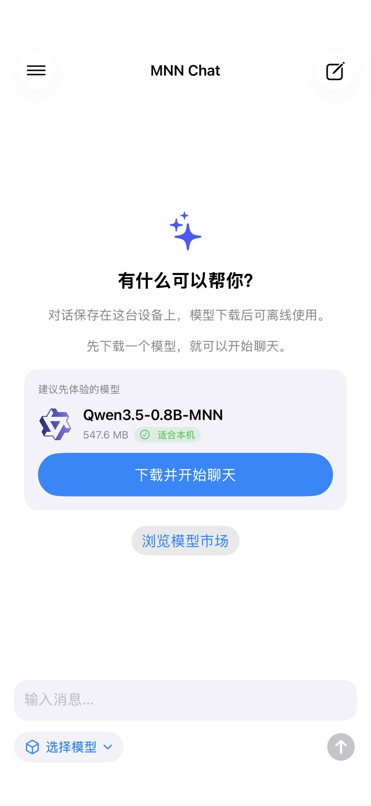
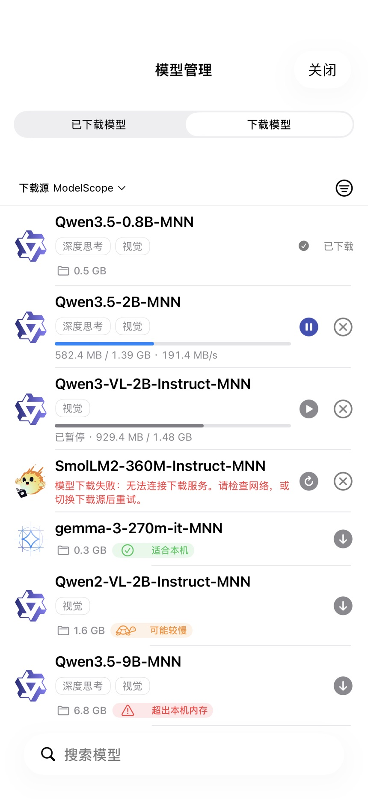
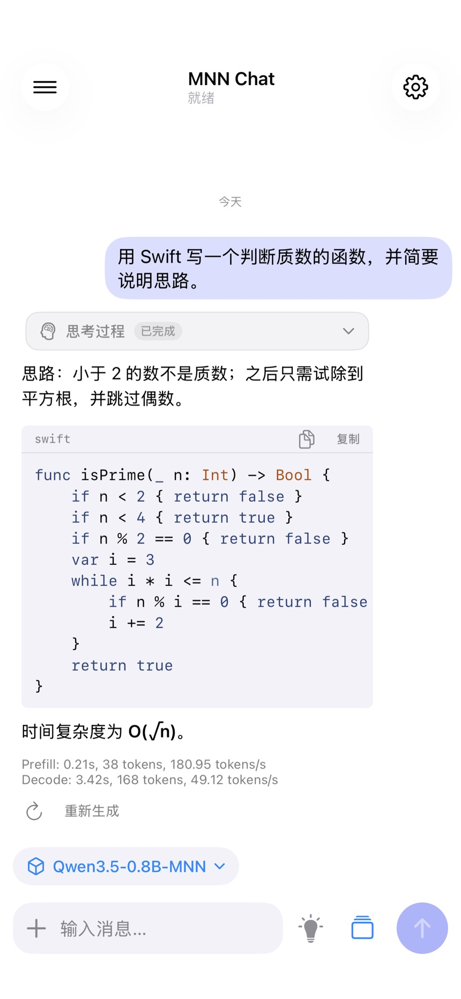
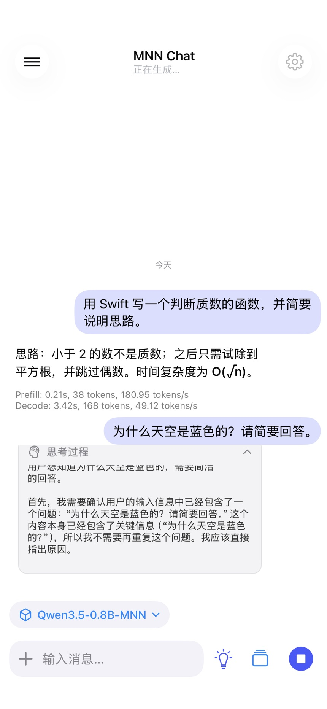
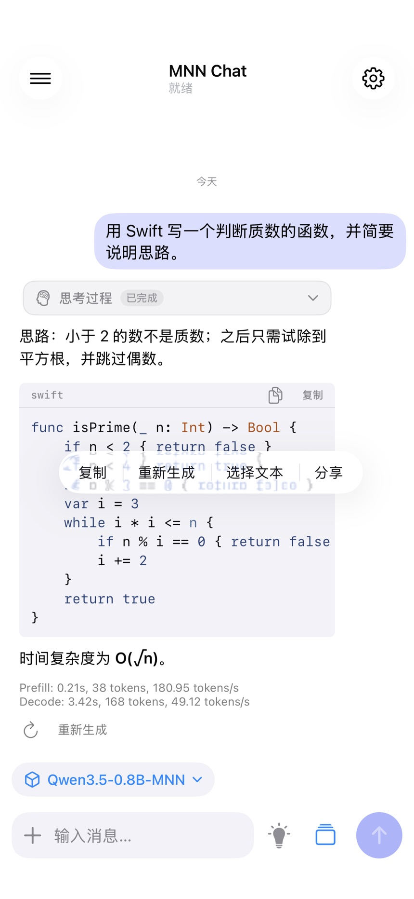
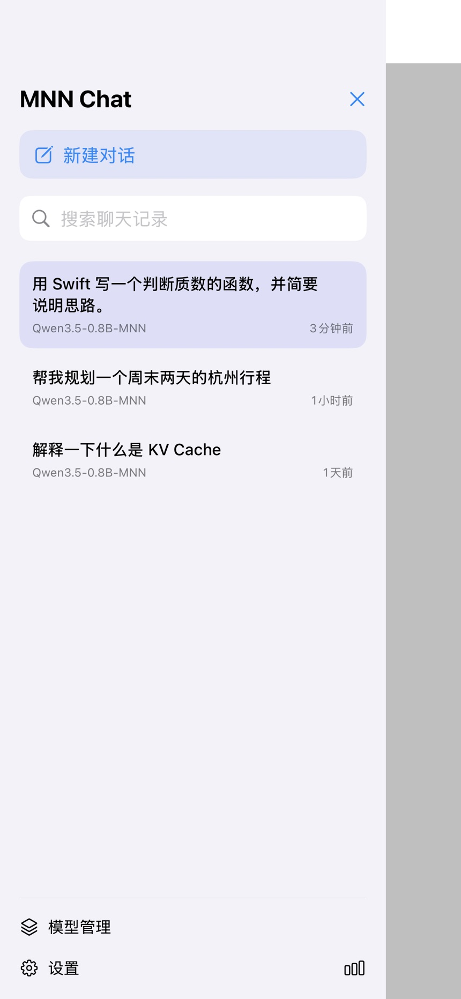
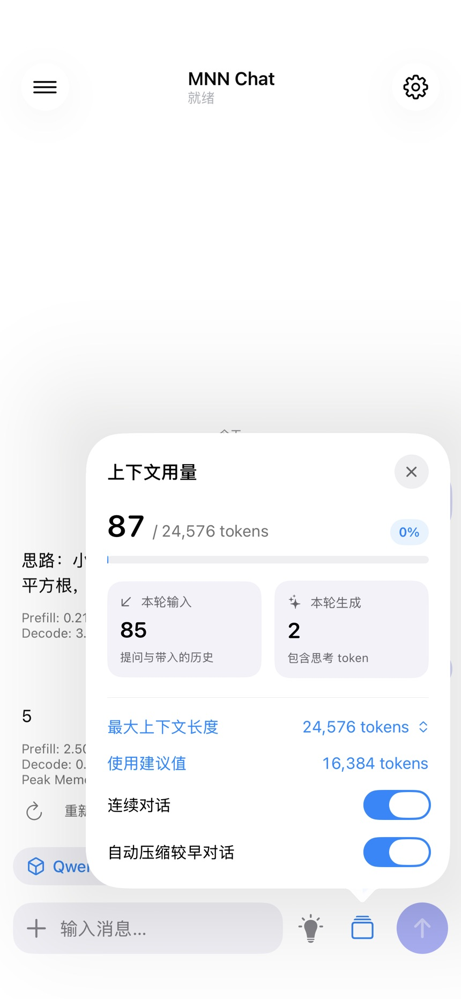
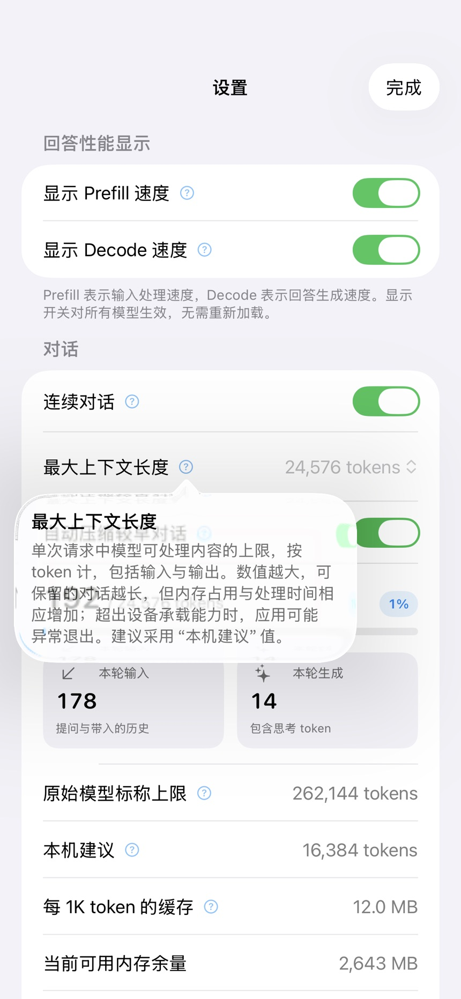
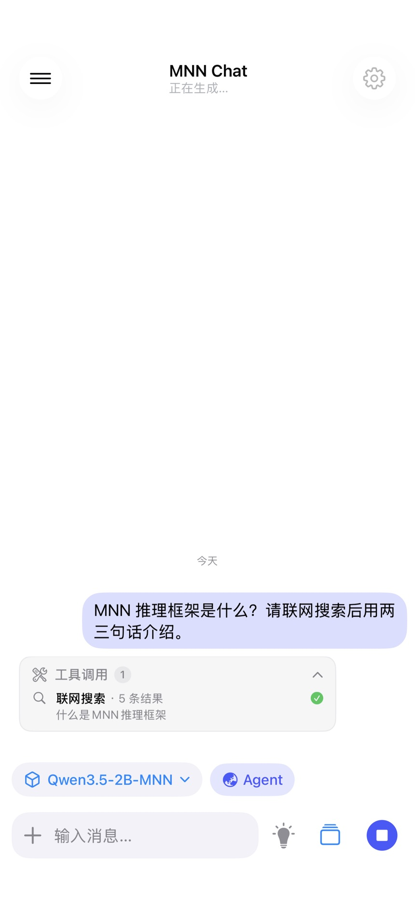
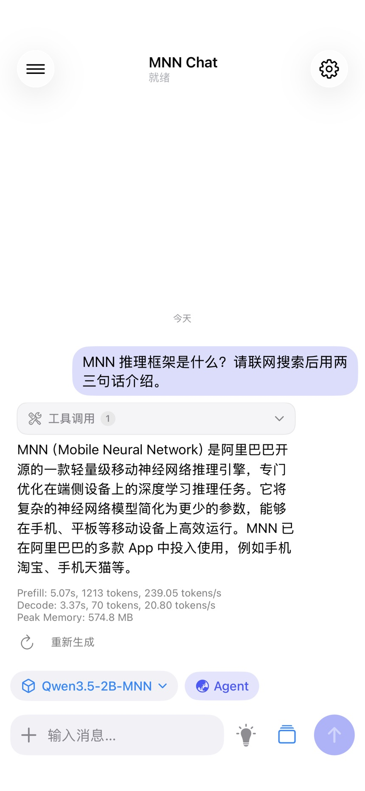

# MNN Chat iOS Application

[查看中文文档](./README-ZH.md)

## Introduction

MNN Chat is an iOS app for running large language models locally with the MNN engine. It supports multimodal conversations with text, image, audio and video input.

Once a model is downloaded, all inference runs on the device and conversations are never uploaded. The app only accesses the network when Agent mode is enabled and a web search is triggered (it sends the search query and fetches result pages).

## Features

1. **First Run and Model Download**
    - With no model downloaded, the home screen shows a recommended model card for one-tap download
    - Model market: list of MNN-supported models with keyword search and tag filters
    - Switchable download sources: ModelScope, Hugging Face, Modelers
    - Device-fit labels estimated from model size and device memory ("Fits this device" / "May be slow" / "Too large for this device")
    - Storage check before downloading; pause, resume, cancel, progress with live speed, inline retry on failure
2. **Model Management**
    - Opened from "Models" at the bottom of the conversation drawer, with "Downloaded" and "Download" tabs
    - Swipe to delete, pin or rename; deletion shows the space to be freed
    - The model in use can be deleted: it is unloaded first (chat history kept), then removed, and another model is selected
3. **Chat Workspace and Conversations**
    - The app opens straight into chat; switch models above the input bar
    - Conversation drawer: search history, swipe to delete, and entries for model management, settings and benchmark
    - Switching between conversations of the same model does not reload the model
4. **Chat Experience**: full Markdown output
    - Separate thinking panel that folds once the answer starts; thinking mode toggled from the input bar or model settings, saved per model
    - Long-press message menu: copy, edit and resend, regenerate, select text, share
    - Code blocks show the language and a copy button
    - Prefill / decode speed after each answer; stop generation, and "Answer directly" when only thinking was produced
5. **Agent Mode**
    - Agent toggle next to the model picker; the model calls tools as needed, and works with small models such as Qwen3.5 0.8B / 2B
    - Built-in tools: web search, read a search-result page, current time, calculator, save memory
    - Tool calls appear in their own collapsible panel, separate from the thinking panel
    - Page reads are limited to sites returned by the search, and the model refers to results by number to avoid invented links
    - Memories and skills can be reviewed and cleared in Settings → Agent Mode
6. **Context Management**
    - Continuous conversation: earlier turns (without thinking) are carried into later prompts
    - Context usage panel showing input, output and total tokens; the icon turns orange at 80%
    - Recommended maximum context length based on available memory and the model's KV cache cost, applied in one tap
    - Older turns are summarized on device when nearing the limit
7. **Model Settings**
    - "?" help popovers next to technical terms, explaining meaning, recommended values and whether a reload is needed
    - Sampler types: Mixed (default) and Greedy; Mixed exposes Penalty, Top K, TFS-Z, Typical, Top P, Min P, Temperature
    - mmap, backend (CPU / Metal), precision, thread count, max output tokens
    - Multimodal prompt API, video frame count, Omni audio output, diffusion parameters
8. **Multimodal**
    - Images: camera or photo library, with automatic resizing, orientation fix and HEIC conversion
    - Video: frames sampled at about 1 fps and sent as images
    - Audio: voice input; Omni models support audio output
    - Diffusion: Stable Diffusion text-to-image and Sana style transfer (e.g., Ghibli style)
9. **Benchmark**
    - Automated prefill speed, decode speed and memory measurements, with batch tests for text, image and audio
10. **App Settings**
    - Instant language switching (Chinese / English); privacy notice, open-source licenses, help and feedback

### Application Preview

| | | | |
|--|--|--|--|
| **Recommended Model** | **Download States** | **Answer** | **Thinking** |
|  |  |  |  |
| **Message Menu** | **Conversation Drawer** | **Context Usage** | **Settings Help** |
|  |  |  |  |
| **Agent Tool Call** | **Agent Answer** | | |
|  |  | | |
